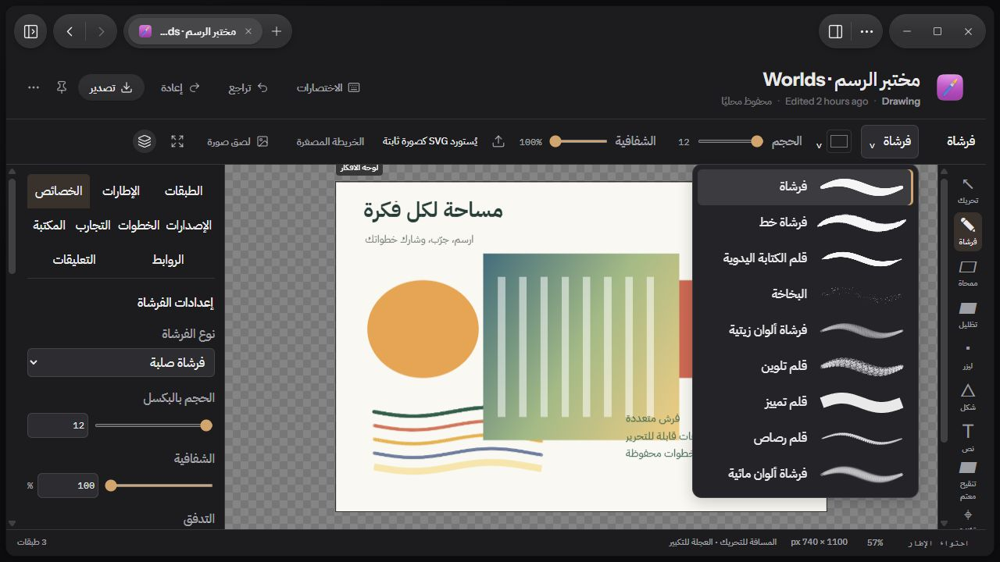
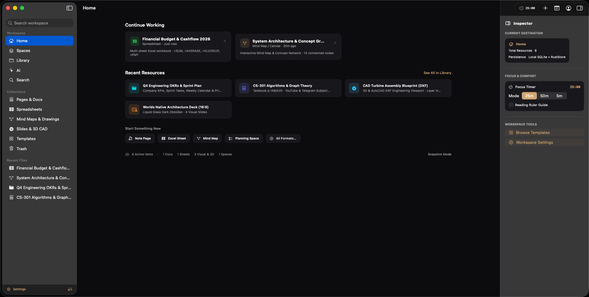
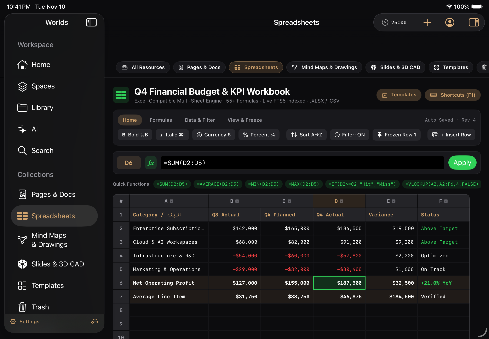
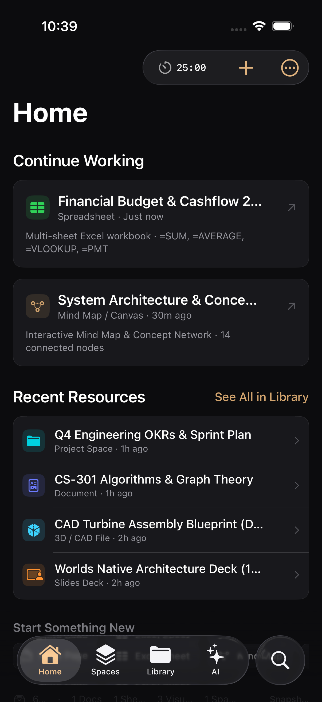
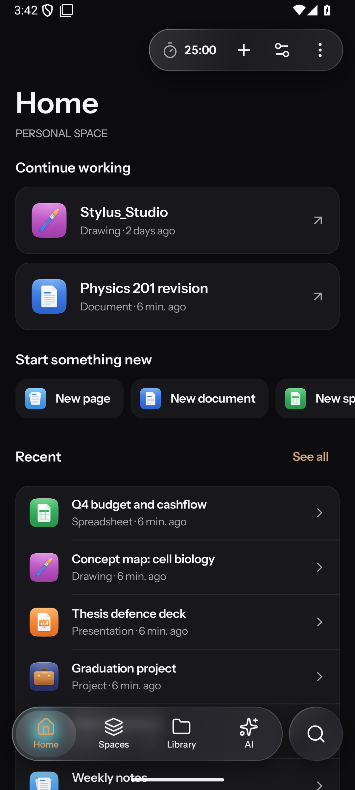

# Worlds

مساحة عمل محلية أولًا للصفحات والمستندات والجداول والرسم والدراسة. بياناتك تبقى على جهازك، والحساب والمزامنة اختياريان.

## المنصات وحالتها

| المنصة | الحالة |
| :--- | :--- |
| ويندوز | الأكمل: الصفحات والمستندات والجداول والرسم وأدوات الطالب، والذكاء عبر Claude Code أو Codex أو مفتاح API من Anthropic وOpenAI وغيرهما أو نموذج محلي مثل Ollama، وواجهة عربية كاملة |
| أندرويد وكروم بوك | تجريبي: الصفحات والرسم والجداول تعمل، وللمهام والتقويم والدراسة (المواد والواجبات والاختبارات والدروس) شاشات دون الأهداف والوارد وعرض الأسبوع، والذكاء يرد ردودًا حقيقية بمفتاح API أو نموذج محلي لكنه لا يعدّل الصفحات بعد |
| آيفون وآيباد وماك | تجريبي: الواجهات الأساسية تعمل، والذكاء يرد ردودًا حقيقية بمفتاح API أو نموذج محلي لكنه لا يعدّل الصفحات بعد، وأجزاء من الرسم ناقصة |

التفاصيل الصادقة لكل ميزة في [مصفوفة أبل](docs/apple-native/FEATURE_PARITY_MATRIX.md) و[مصفوفة أندرويد](docs/android-native/FEATURE_PARITY_MATRIX.md).

## جرّبه في المتصفح

تتوفر نسخة عرض تعمل في المتصفح مع مساحة طالب تجريبية، دون تثبيت. يبقى كل شيء داخل التبويب، وتُنشر عبر مسار Web demo في GitHub Actions.

## التحميل والتثبيت

حمّل آخر إصدار من [صفحة الإصدارات](https://github.com/justpainful/Worlds/releases/latest). الملفات غير موقّعة رقميًا:

- **ويندوز:** شغّل المثبّت، وإذا ظهر تحذير اختر More info ثم Run anyway. للتأكد أن الملف لم يتغير، قارن ناتج `Get-FileHash <الملف>` في PowerShell بالبصمة في `SHA256SUMS.txt`.
- **أندرويد:** افتح ملف APK واسمح بالتثبيت من هذا المصدر. الملف موقّع بمفتاح تطوير.
- **آيفون وآيباد:** وقّع ملف IPA وثبّته بأداة مثل SideStore أو AltStore أو Sideloadly.
- **ماك:** انقل التطبيق إلى Applications، وافتحه أول مرة بالزر الأيمن ثم Open.

## البناء من المصدر

- **ويندوز:** Node 22 وpnpm وRust، ثم `pnpm install` و`pnpm tauri dev`.
- **أندرويد:** JDK 17 وAndroid SDK، ثم من مجلد `Android` شغّل `gradlew assembleDebug`.
- **أبل:** على ماك مع Xcode وXcodeGen، شغّل `xcodegen` داخل `Apple` ثم افتح المشروع.

## الرخصة

لم تُحدَّد بعد.

---

# Worlds (English)

A local-first workspace for pages, documents, spreadsheets, drawing and study. Your data stays on your device; accounts and sync are optional.

## Platforms and status

| Platform | Status |
| :--- | :--- |
| Windows | Most complete: pages, documents, spreadsheets, drawing, study tools, a full Arabic interface, and AI through Claude Code, Codex, an API key (Anthropic, OpenAI and others) or a local model such as Ollama |
| Android and ChromeOS | Preview: pages, drawing and spreadsheets work; Tasks, Calendar and Study (subjects, assignments, exams, lessons) have screens, without goals, the inbox or the week grid; AI gives real replies with an API key or a local model but cannot edit pages yet |
| iPhone, iPad and Mac | Preview: core views work; AI gives real replies with an API key or a local model but cannot edit pages yet; parts of drawing are incomplete |

Feature by feature status: [Apple matrix](docs/apple-native/FEATURE_PARITY_MATRIX.md), [Android matrix](docs/android-native/FEATURE_PARITY_MATRIX.md).

## Try it in the browser

A browser demo with a sample student workspace runs without installing anything; everything stays in the tab. It is published by the Web demo workflow in GitHub Actions.

## Download and install

Get the latest build from the [releases page](https://github.com/justpainful/Worlds/releases/latest). Builds are not code-signed: on Windows choose More info, then Run anyway, and compare `Get-FileHash` with `SHA256SUMS.txt` to check the file; the Android APK uses a development key; IPA files must be signed with a tool such as SideStore, AltStore or Sideloadly; on Mac open the app the first time with right click, then Open.

## Build from source

- **Windows:** Node 22, pnpm and Rust, then `pnpm install` and `pnpm tauri dev`.
- **Android:** JDK 17 and the Android SDK, then `gradlew assembleDebug` in `Android`.
- **Apple:** on a Mac with Xcode and XcodeGen, run `xcodegen` in `Apple` and open the project.

## License

To be decided.
