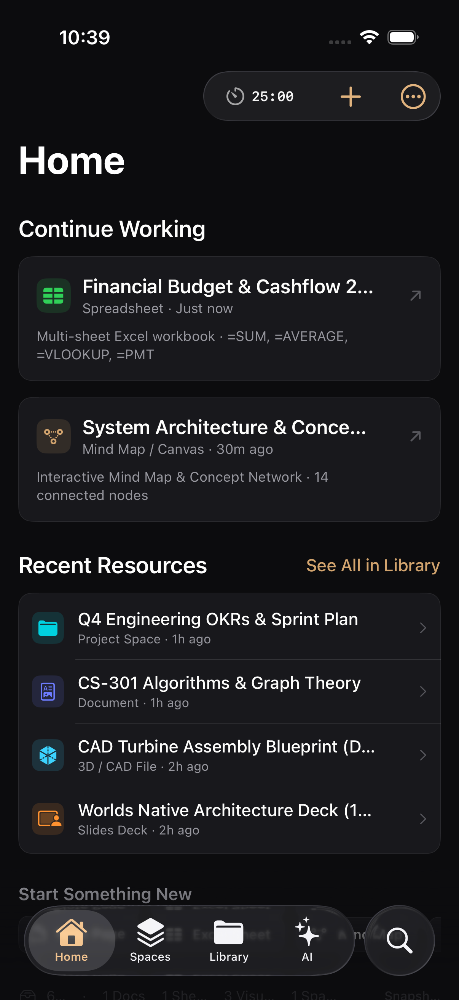
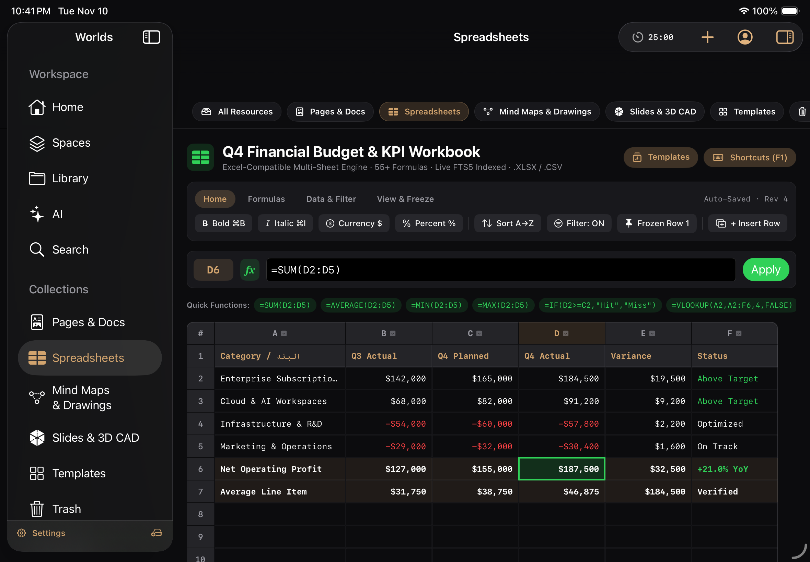
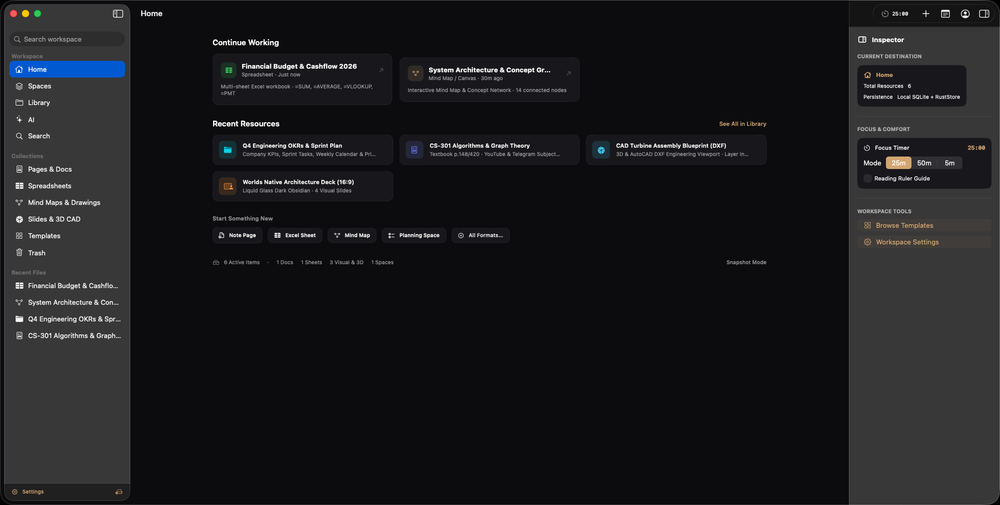
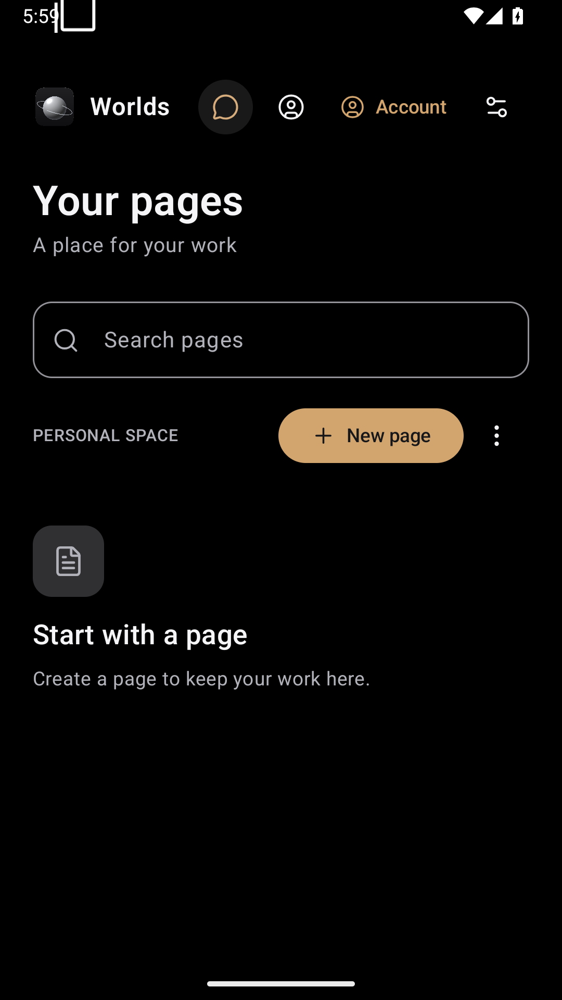
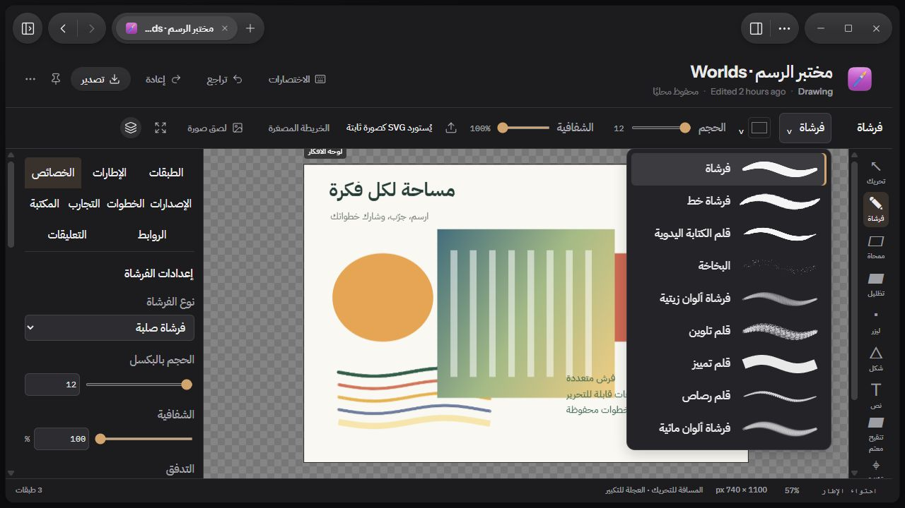

# Worlds 0.2.0

من أكبر تحديثات Worlds حتى الآن. التطبيق صار متاحًا على ويندوز وأندرويد وكروم بوك وآيفون وآيباد وماك، ومعه أدوات الطالب والتخطيط والجداول، ومساحة رسم كاملة.

## التحميل

| المنصة | الملف | المتطلبات |
| :--- | :--- | :--- |
| ويندوز | `Worlds-0.2.0-Windows-x64-setup.exe` | ويندوز 10 أو 11، 64 بت |
| أندرويد وكروم بوك | `Worlds-0.2.0-Android-Universal.apk` | أندرويد 8.0 أو أحدث |
| آيفون | `Worlds-0.2.0-iPhone-Unsigned.ipa` | iOS 17 أو أحدث |
| آيباد | `Worlds-0.2.0-iPad-Unsigned.ipa` | iPadOS 17 أو أحدث |
| ماك | `Worlds-0.2.0-macOS-Unsigned.dmg` أو `.zip` | macOS 14 أو أحدث |

بصمات الملفات موجودة في `SHA256SUMS.txt`.

### طريقة التثبيت

- **ويندوز:** شغّل المثبّت. إذا ظهرت رسالة "Windows protected your PC" اختر More info ثم Run anyway، لأن التطبيق غير موقّع رقميًا. يعمل التطبيق على Microsoft Edge WebView2 الموجود في أغلب الأجهزة.
- **أندرويد:** افتح ملف APK واسمح بالتثبيت من هذا المصدر. الملف موقّع بمفتاح تطوير وليس مفتاح نشر، ولذلك قد تحتاج إلى حذف أي نسخة موقّعة بمفتاح آخر قبل تثبيته.
- **كروم بوك:** فعّل تصحيح ADB من إعدادات المطورين، ثم ثبّت الملف بالأمر `adb install`.
- **آيفون وآيباد:** الملفات غير موقّعة، وتحتاج إلى توقيعها وتثبيتها بأداة مثل SideStore أو AltStore أو Sideloadly.
- **ماك:** انقل Worlds إلى مجلد Applications. لأنه غير موقّع، افتحه أول مرة بالنقر بالزر الأيمن ثم Open، أو اسمح به من Privacy & Security.

## المنصات الجديدة

### آيفون

تطبيق أصلي بخمس وجهات: الرئيسية والمساحات والمكتبة والذكاء الاصطناعي والبحث، مع شريط تبويب عائم بتأثير Liquid Glass وشريط أدوات علوي يجمع مؤقت التركيز والإنشاء والمزيد.

### آيباد

واجهة مقسّمة قابلة للطي، وشريط جانبي يفصل مساحة العمل عن المجموعات، ومنطقة عمل واسعة، ولوحة Inspector تُفتح وتُخفى عند الحاجة.

### ماك

تطبيق سطح مكتب بشريط جانبي شفاف، وشريط أدوات مدمج بالنافذة، وقوائم واختصارات ماك، ولوحة Inspector، و Hot Corners مع نافذة Quick Note العائمة.

صور أبل ملتقطة من التشغيل الآلي وتعرض بيانات تجريبية.

### أندرويد وكروم بوك

تطبيق أصلي يعمل على الهواتف والأجهزة اللوحية والأجهزة القابلة للطي وكروم بوك. يشمل الصفحات والمستندات والرسم بدعم S Pen وأقلام USI، ومحادثة الذكاء الاصطناعي، والأتمتة، وديسكورد، والملف الشخصي، والطباعة إلى PDF، والمساحات المشتركة مع العمل دون اتصال، وواجهة عربية كاملة.

### ويندوز

النسخة الأكمل من التطبيق، وتضم كل أدوات الطالب والرسم الموضحة أدناه.

## أدوات الطالب والتخطيط

- **المواد:** صفحة لكل مادة تجمع المعلم والجدول والدروس والواجبات والاختبارات.
- **الواجبات والاختبارات:** مواعيد تسليم ودرجات، ونطاق كل اختبار ونتيجته.
- **المطلوب إحضاره:** قائمة بما يجب إحضاره أو طباعته أو تجهيزه.
- **الكتب والروابط:** الكتب وكتب الحلول، وروابط يوتيوب وتيليجرام و Classroom ومدرستي داخل المادة.
- **التخطيط:** المهام بخطوات وأولويات وتكرار، والأحداث، والتقويم، والأهداف، وصندوق وارد للالتقاط السريع.
- **مؤقت التركيز** لجلسات الدراسة.
- **الجداول:** جداول بأوراق متعددة ومعادلات وفرز وتصفية وتجميد صفوف، مع استيراد وتصدير XLSX و CSV.
- **حزمة الدراسة اختيارية،** تُفعّل من الإعدادات ولا تظهر لمن لا يحتاجها.

تتوفر هذه الأدوات كاملة على ويندوز، وبواجهات أصلية على أجهزة أبل. على أندرويد تتوفر شاشة الجداول، ويحفظ التطبيق أنواع الدراسة والتخطيط بصيغة متوافقة، أما شاشاتها الكاملة فلم تكتمل بعد.

## أدوات الرسم

- **الفرش:** فرشاة وفرشاة خط وقلم كتابة يدوية وبخاخ وألوان زيتية ومائية وقلم تلوين وقلم تمييز وقلم رصاص، مع إعدادات مفصلة.
- **ليزر للشرح،** ورسم مباشر فوق الشاشة.
- **الطبقات:** بحث وعزل ودمج وأقنعة.
- **التحديد والتحويل:** قلم تحديد، وتحريك البكسلات، وتكرار الضربات.
- **الأشكال والمسارات** مع تصحيح تلقائي للأشكال، ونص عربي وإنجليزي.
- **الصور:** قص وأقنعة وتحويل إلى بكسلات وحجب المعلومات الحساسة.
- **الإطارات والخطوات والتجارب** للعرض ومقارنة الأفكار، والإصدارات لاسترجاع العمل.
- **المكتبة** لإعادة استخدام العناصر، والتعليقات والروابط المكانية مع صفحات Worlds ومهامها.
- **قوالب خرائط ذهنية:** متفرعة، ومفاهيمية، وعظم السمكة، و SWOT.
- **تصدير** PNG و SVG وحزم المشاريع، مع نقل المعالجة الثقيلة إلى خيوط خلفية حتى تبقى الواجهة سريعة.

## حالة التحقق

- **أبل:** نجحت اختبارات الواجهة والحزم 8 من 8 في التشغيل الآلي `42914551411`.
- **ويندوز:** بُني المثبّت من شيفرة الإصدار النظيفة.
- **أندرويد:** بُني الملف بنجاح من آخر شيفرة. نجحت فحوصات النواة والحزم، لكن بعض اختبارات الواجهة ما زالت تفشل على محاكي أندرويد 11 و 15، فاعتبر نسخة أندرويد تجريبية.

## ملاحظات معروفة

- ملفات هذا الإصدار تعرض رقم الإصدار الداخلي 0.1.0، لأن رقم الإصدار لم يتغير في الشيفرة.
- ملفات ويندوز وأبل غير موقّعة رقميًا، وملف أندرويد موقّع بمفتاح تطوير.
- بعض ميزات أندرويد ما زالت جزئية، والتفاصيل في `docs/android-native/FEATURE_PARITY_MATRIX.md`.

---

# Worlds 0.2.0 (English)

One of the largest Worlds updates so far. Worlds now runs on Windows, Android, ChromeOS, iPhone, iPad and Mac, and adds student and planning tools, spreadsheets and a full drawing workspace.

## Downloads

| Platform | File | Requires |
| :--- | :--- | :--- |
| Windows | `Worlds-0.2.0-Windows-x64-setup.exe` | Windows 10 or 11, 64-bit |
| Android and ChromeOS | `Worlds-0.2.0-Android-Universal.apk` | Android 8.0 or later |
| iPhone | `Worlds-0.2.0-iPhone-Unsigned.ipa` | iOS 17 or later |
| iPad | `Worlds-0.2.0-iPad-Unsigned.ipa` | iPadOS 17 or later |
| Mac | `Worlds-0.2.0-macOS-Unsigned.dmg` or `.zip` | macOS 14 or later |

Checksums are in `SHA256SUMS.txt`. The Windows and Apple files are not code-signed, and the IPA files must be signed with a tool such as SideStore, AltStore or Sideloadly. The Android APK is signed with a development key.

## What is new

- **Native apps** for iPhone, iPad and Mac with Liquid Glass navigation, and for Android and ChromeOS with stylus support, AI chat, automations, Discord, printing to PDF and shared offline workspaces.
- **Student tools:** subjects, lessons, assignments, exams, things to bring, textbooks and links.
- **Planning:** tasks, events, calendar, goals, an inbox and a focus timer.
- **Spreadsheets** with multiple sheets, formulas, sorting, filters, frozen rows, and XLSX and CSV.
- **Drawing:** brushes, laser and screen drawing, layers, masks, selection, shapes, Arabic and English text, image tools, frames, steps, experiments, a reusable library, comments, mind map templates and export.

The full student and planning tools are on Windows, with native views on Apple devices. Android has the spreadsheet screen and stores study and planning items in a compatible format, but their full screens are not finished yet.

## Verification

- **Apple:** UI tests and packaging passed 8 of 8 in CI run `42914551411`. Apple screenshots show sample data.
- **Windows:** the installer was built from the clean release source.
- **Android:** the APK built successfully from the latest source. Core and package checks pass, but some UI tests still fail on the Android 11 and 15 emulators, so treat the Android build as a preview.

## Known notes

- These builds report internal version 0.1.0 because the version number in the source was not changed.
- Some Android features are still partial. See `docs/android-native/FEATURE_PARITY_MATRIX.md`.
