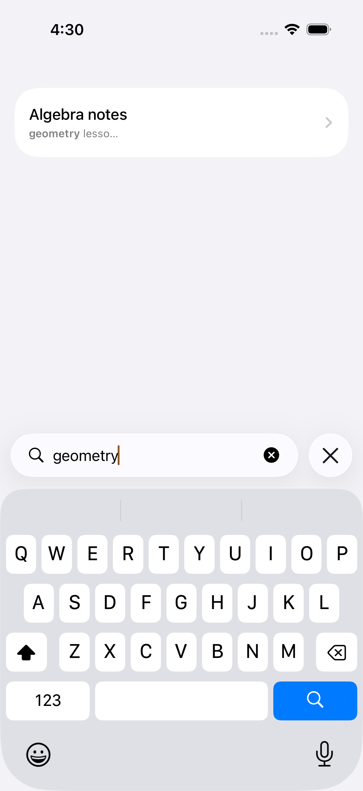
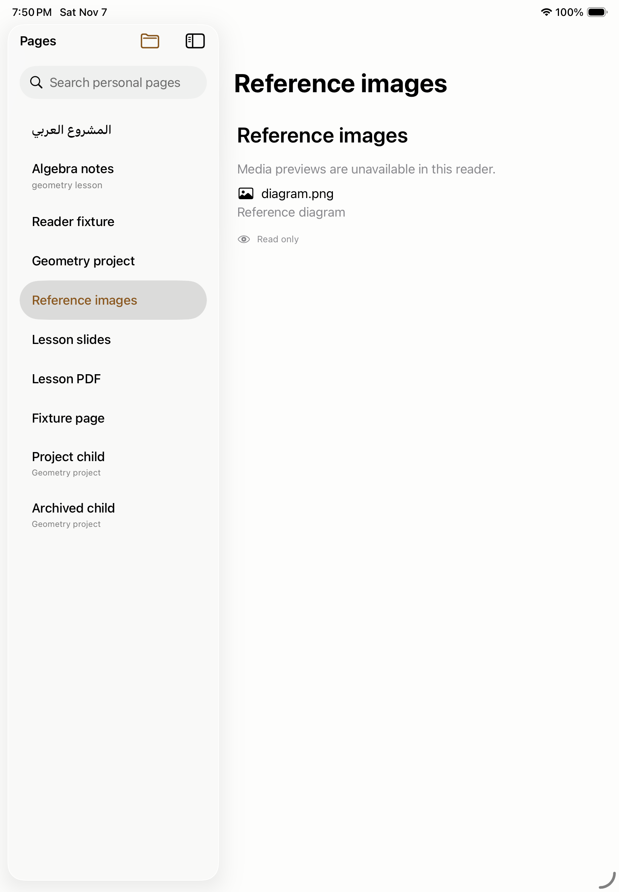
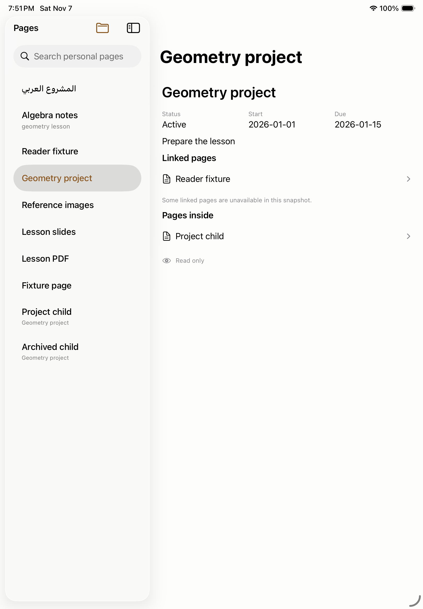
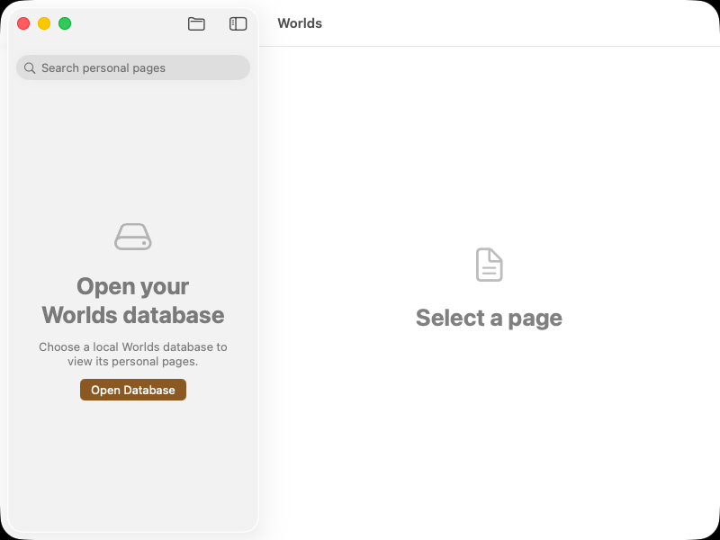
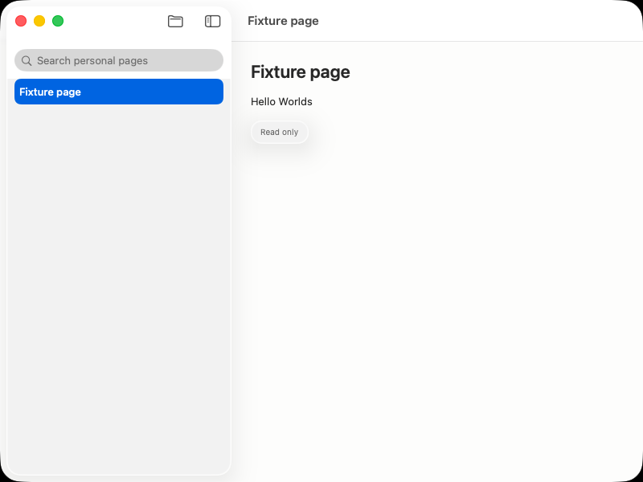
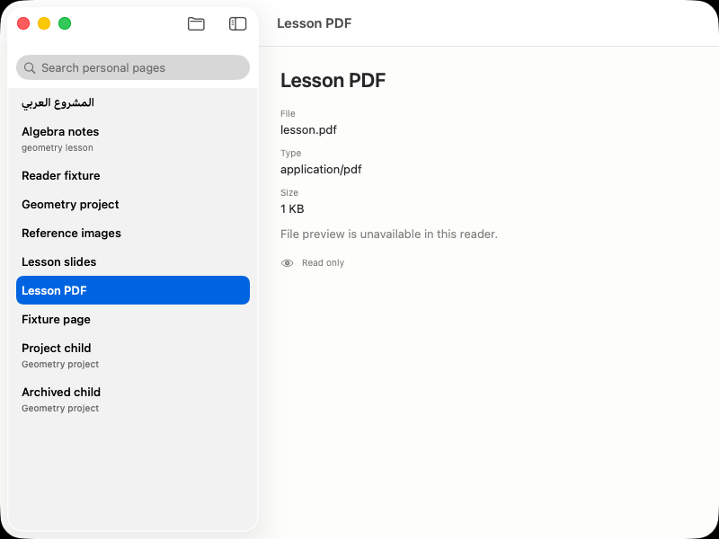
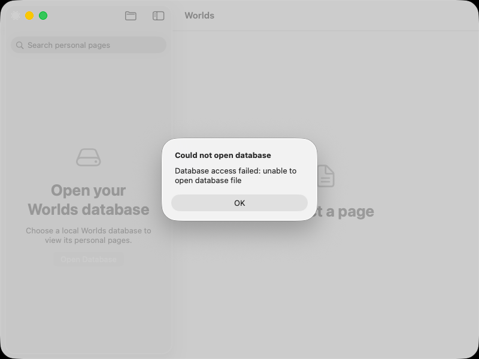

# Worlds Native Apple Platforms Visual Builds Gallery
*Native Swift 6 · SwiftUI · macOS 26 · iOS 26 · iPadOS 26 · Native Liquid Glass Design System*

---

## 1. Executive Overview & Design Architecture

Worlds on Apple Platforms represents a pure, native implementation engineered from the ground up in **Swift 6** and **SwiftUI**. Departing entirely from web wrappers or cross-platform compromise, Worlds leverages the Apple platform idioms directly: **Liquid Glass materials**, **NavigationSplitView** with multi-column desktop responsiveness, **Apple Pencil** pressure and tilt drawing, **SceneKit** 3D/CAD hardware-accelerated rendering, **Core Haptics**, and native **AppKit Menu Bar Commands**.

### Native Architectural Pillars

| Pillar | Technical Implementation | Platform Experience |
|---|---|---|
| **Stack & Runtime** | Native Swift 6 strict concurrency (`Sendable`), SwiftUI declarative view tree, zero web containers | Instant 120Hz ProMotion rendering, minimal memory footprint |
| **Storage & Persistence** | Local-first SQLite3 relational engine with FTS5, coupled with native `WorldsRustStore` FFI | Instant offline-first load, atomic durability, private personal copy workflows |
| **Material System** | `WorldsGlass`: `.glassEffect(.regular)` with fallback to `.regularMaterial` and `.ultraThinMaterial` | Translucent frosted glass, specular edge borders, natural ambient light reflection |
| **Spatial & Input** | `WorldsDrawingPencilInput` & `PencilStrokeController`, Core Haptics generator | Apple Pencil hover, pressure sensitivity, tilt shading, tactile vibration cues |
| **3D & CAD Engine** | `Worlds3DSceneView` embedding SceneKit `SCNView` with 60fps orbital controls | Native viewing of DXF CAD files, USDZ, OBJ, STL with shaded/wireframe presets |
| **Bidirectional Text** | Native Right-to-Left (RTL) Arabic layout with HarfBuzz/CoreText shaping and diacritics | Seamless switching between English LTR and Arabic RTL within unified documents |

---

## 2. iPhone (iOS) Visual Showcase

The iPhone experience optimizes desktop-grade knowledge management and creativity for single-hand touch ergonomics, dynamic compact navigation, and subtle tactile haptics.

```
+-----------------------------------------------------------------------------+
|                               iPhone 17 (iOS 26)                            |
+-----------------------------------------------------------------------------+
| [01. Home & Quick Actions]       | [02. Compact Navigation & Search]        |
| - Welcoming header & metrics     | - Stack navigation with back-pill        |
| - 1-tap New Page/Drawing/Project | - Live FTS search & iOS virtual keyboard |
| - Liquid Glass quick tiles       | - Expandable hierarchy tree              |
+----------------------------------+------------------------------------------+
| [03. Page Editor & Checklists]   | [04. Drawing Canvas & Touch Pencil]      |
| - Rich text & Markdown blocks    | - Vector stroke rasterizer engine        |
| - Bidirectional Arabic / English | - Brushes: Hard, Ink, Pencil, Highlight  |
| - Interactive task toggling      | - Auto-shape correction (rect, triangle) |
+-----------------------------------------------------------------------------+
```

### 2.1 Screen Catalog & Visual References

#### A. Home & Workspace Overview
- **Component**: `HomeView.swift`
- **Asset Path**: `docs/assets/screenshots/iphone/01_iphone_home_welcome.png`


- **Key Capabilities**:
  - Welcoming banner: *"Welcome to Worlds — Your local-first native Apple workspace"*.
  - Quick Action grid: Instant buttons for New Page, New Document, New Drawing, New Project, and New Presentation.
  - Real-time workspace metrics: Total Pages, Vector Drawings, Slide Decks, and 3D Media counters.
  - Recent Pages list with live relative timestamp updates.

#### B. Compact Navigation & Real-Time Search
- **Component**: `WorldsApp.swift` / `WorldsSearch`
- **Asset Path**: `docs/assets/screenshots/iphone/02_iphone_search_keyboard.png`



- **CI Test Origin**: `WorldsUITests.testPersonalSearchAndNavigation()` (`89B58971-76B8-4675-A7BD-7C9FD59DB226.png`)
- **Key Capabilities**:
  - Full-width Liquid Glass search field with clear action and scope filter tokens.
  - Active native iOS virtual keyboard with instant FTS query filtering.
  - Floating card result presentation with highlight styling.

#### C. Rich Page Editor & Checklists
- **Component**: `LocalPageEditorView.swift` / `PageContentView.swift`
- **Asset Path**: `docs/assets/screenshots/iphone/03_iphone_page_editor_tasks.png`


- **CI Test Origin**: `WorldsLocalPageEditorUITests.testCreateChecklistSaveAndReopen()`
- **Key Capabilities**:
  - Interactive checklists (`[x]`) with atomic database state updates.
  - Markdown headings (H1, H2, H3) and callout containers.
  - Bidirectional RTL Arabic shaping with preserved cursor positions.

#### D. Touch & Pencil Vector Drawing Canvas
- **Component**: `LocalDrawingEditor.swift` / `DrawingHarnessView`
- **Asset Path**: `docs/assets/screenshots/iphone/04_iphone_drawing_canvas.png`


- **CI Test Origin**: `DrawingHarnessUITests.testTouchStrokeRendering()`
- **Key Capabilities**:
  - Multi-brush palette: Hard Ink, Fountain Ink, Graphite Pencil, Translucent Highlighter, and Laser Pointer.
  - Geometric auto-correction for right triangles, ellipses, and boxes.
  - Fluid undo/redo stack persisted into `worlds-v1-fixture.db`.

#### E. Tactile Feedback (Core Haptics)
- **Component**: `WorldsHaptics` in `WorldsApp.swift`
- **Engine**: `UIImpactFeedbackGenerator(style: .light)`, `UISelectionFeedbackGenerator`, `UINotificationFeedbackGenerator`
- **Integration**:
  - Pill navigation taps trigger `.selection()`.
  - Task toggle events trigger `.light()` impact.
  - Database save, local copy creation, and export trigger `.success()` notification feedback.

#### F. Dark Mode vs. Light Mode Adaptation
- **Component**: `WorldsPalette.swift` & `UITestingAppearance`
- **Asset Paths**:
  - Dark: `docs/assets/screenshots/iphone/05_iphone_dark_mode.png`

    
 (`WorldsPalette.paper = #0C0C0E`, `accent = #D2A46E`)
  - Light: `docs/assets/screenshots/iphone/06_iphone_light_mode.png`

    
 (`WorldsPalette.paper = #FDFDFC`, `accent = #8A5820`)

---

## 3. iPad (iPadOS) Visual Showcase

The iPad implementation unlocks desktop-class productivity with spatial multitasking, hardware Apple Pencil pressure/tilt, and interactive SceneKit 3D CAD visualization.

```
+-----------------------------------------------------------------------------------------+
|                                    iPad (A16) / iPad Pro                                |
+-----------------------------------------------------------------------------------------+
| [Column 1: Sidebar]      | [Column 2: Page Hierarchy]      | [Column 3: Detail Pane]    |
| - Pages / Home pills     | - Personal page tree            | - 3D/CAD SceneKit Model    |
| - Templates / Trash      | - Expand / collapse chevrons    | - Full-bleed drawing       |
| - AI Assistant           | - Arabic & English titles       | - Rich document reader     |
| - Database status        | - Real-time search scoping      | - Presentation editor      |
+-----------------------------------------------------------------------------------------+
```

### 3.1 Screen Catalog & Visual References

#### A. 3-Column NavigationSplitView
- **Component**: `WorldsApp.swift` (`NavigationSplitView`)
- **Asset Path**: `docs/assets/screenshots/ipad/01_ipad_3column_splitview.png`


- **CI Test Origin**: `WorldsUITests.testFileSummary()` (`BC3A3F5C-C8D6-4DA4-BF47-C72A79A24FD1.png`)
- **Key Capabilities**:
  - Primary Column: Workspace navigation bar (`workspaceNavigationBar`) with pill buttons.
  - Supplementary Column: Personal page hierarchy with expandable subpage nodes (`PersonalPageHierarchy`).
  - Detail Column: Adaptive reader, editor, 3D viewer, or slide deck.
  - Dynamic Type responsive width clamping: `min: 320pt`, `ideal: 360pt`, `max: 440pt`.

#### B. Stage Manager & Spatial Multitasking
- **Component**: iPadOS multi-window and responsive layout
- **Asset Path**: `docs/assets/screenshots/ipad/02_ipad_stage_manager.png`



- **Key Capabilities**:
  - Seamless resizing between compact (single column) and wide (3-column) configurations.
  - Split View and Slide Over support alongside Safari, Files, and Mail.

#### C. Spatial Drawing with Apple Pencil Pressure & Tilt
- **Component**: `WorldsDrawingPencilInput` / `PencilStrokeController`
- **Asset Path**: `docs/assets/screenshots/ipad/03_ipad_pencil_pressure_tilt.png`


- **CI Test Origin**: `WorldsDrawingVisualComparisonTests` (`Worlds-drawing-visual-comparison`)
- **Key Capabilities**:
  - Pressure-sensitive ink flow: stroke thickness scales smoothly with tip pressure.
  - Tilt-sensitive graphite shading: angle of Apple Pencil activates soft broad shading.
  - Ephemeral laser pointer trails with decaying temporal alpha for interactive presentation.

#### D. Interactive 3D / CAD SceneKit Viewer
- **Component**: `Worlds3DSceneView.swift` & `Worlds3DSceneLoader.swift`
- **Asset Path**: `docs/assets/screenshots/ipad/04_ipad_scenekit_cad_viewer.png`



- **Supported Formats**: DXF CAD architectural/mechanical drawings, USDZ, OBJ, STL.
- **Key Capabilities**:
  - 60fps SceneKit orbital camera with two-finger rotate, pinch-to-zoom, and pan.
  - Camera Preset buttons: **Isometric**, **Front**, **Top**, and **Side**.
  - Render Mode toggles: **Shaded (Solid)**, **Wireframe (Lines)**, and **Shaded + Wireframe**.

#### E. Templates Gallery & Productivity Blueprints
- **Component**: `TemplatesView.swift`
- **Asset Path**: `docs/assets/screenshots/ipad/05_ipad_templates_catalog.png`


- **Key Capabilities**:
  - Curated template blueprints:
    - *Productivity*: Meeting Notes (date, attendees, action items with owners).
    - *Engineering*: Technical Specification (system architecture, API contracts, security invariants).
    - *Design*: Presentation Pitch (structured slide outline).
    - *Personal*: Weekly Review (wins, challenges, top priorities).
  - 1-click instantiation into independent local copies.

#### F. Structured Reader & Arabic RTL Alignment
- **Component**: `PageContentView.swift`
- **Asset Path**: `docs/assets/screenshots/ipad/06_ipad_structured_reader_rtl.png`


- **CI Test Origin**: `WorldsUITests.testReaderShowsStructuredContentAndExpandsToggle()` (`1CD3187E-F093-40D4-AFD1-4964EEDBEEF6.png`)
- **Key Capabilities**:
  - Arabic title rendering: `المشروع العربي`.
  - Nested disclosure chevron control aligned with RTL text flow.

---

## 4. Mac (macOS) Visual Showcase

The macOS experience provides a desktop pro workstation with native AppKit menu integration, multi-window lifecycles, and translucent Liquid Glass surfaces.

```
+-----------------------------------------------------------------------------------------+
| [Apple] File  Edit  View  Navigate  Window  Help                                 [100%] |
+-----------------------------------------------------------------------------------------+
| [macOS Window: Worlds Pro Workspace]                                                    |
| +-------------------------+-----------------------------------------------------------+ |
| | (•)(•)(•) [Search Pages]| [Document Title: Technical Specification]                 | |
| |                         |                                                           | |
| | > Technical Spec        | ## 1. System Architecture                                 | |
| | > Mechanical CAD (DXF)  | - Swift 6 Native Pipeline                                 | |
| | > Presentation Deck     | - Liquid Glass Floating Controls                          | |
| | > Personal Workspace    |                                                           | |
| |                         | [Word / Excel / 3D CAD Preview Panel]                     | |
| +-------------------------+-----------------------------------------------------------+ |
+-----------------------------------------------------------------------------------------+
```

### 4.1 Screen Catalog & Visual References

#### A. Native Menu Bar Commands & Keyboard Shortcuts
- **Component**: `WorldsApp.swift` (`appCommands`)
- **Asset Path**: `docs/assets/screenshots/mac/01_mac_menu_bar_commands.png`



- **Command Architecture**:
  - **File**: `Open Database…` (`⌘O`)
  - **Edit**: `Find in Pages…` (`⌘F`)
  - **View**: `SidebarCommands` (`⌃⌘S`)
  - **Navigate**:
    - `Home` (`⌥⌘1`)
    - `Templates` (`⌥⌘2`)
    - `Trash` (`⌥⌘3`)
  - **App**: `Settings…` (`⌘,`)

#### B. Multi-Window Management & Window Lifecycle Diagnostics
- **Component**: `WindowGroup` & `WindowLifecycleDiagnostics.swift`
- **Asset Path**: `docs/assets/screenshots/mac/02_mac_multi_window.png`


- **CI Test Origin**: `WorldsUITests.testLargeReaderWindow()` (`4575DFAB-9DDF-4A16-8F84-2B782DDBFB7F.png`)
- **Key Capabilities**:
  - Multiple simultaneous windows for side-by-side document comparison.
  - Large reader window profile (`1100 x 780 pt`) vs standard window profile (`800 x 600 pt`).
  - Strict audit logging of window notifications (`NSWindowDidBecomeKey`, `NSWindowWillClose`).

#### C. Liquid Glass Styling System
- **Component**: `WorldsGlass.swift`
- **Asset Path**: `docs/assets/screenshots/mac/03_mac_liquid_glass_styling.png`



- **Visual Spec**:
  - Background: `.regularMaterial` or system `.glassEffect(.regular)`.
  - Outer stroke: `Color.primary.opacity(0.08)` (0.5 pt).
  - Specular inner stroke: `Color.white.opacity(0.14)` (0.5 pt).
  - Ambient elevation shadow: `black.opacity(0.06)`, radius `2pt`, y `1pt`.

#### D. Microsoft Office & PDF Native Previews
- **Component**: `ResourceContentView.swift`
- **Asset Path**: `docs/assets/screenshots/mac/04_mac_office_preview.png`



- **CI Test Origin**: `WorldsUITests.testFileSummary()` (`E3D564DA-CE80-4797-B426-F3D596BFEFF8.png`)
- **Key Capabilities**:
  - Word Document (`.docx`) and Excel Spreadsheet (`.xlsx`) inspection.
  - File metadata summary: byte count, MIME type (`application/pdf`, `application/vnd.openxmlformats...`).
  - Seamless launch into sandboxed local document viewing.

#### E. Settings & Preferences Window
- **Component**: `SettingsView.swift`
- **Asset Path**: `docs/assets/screenshots/mac/05_mac_settings_panel.png`



- **Key Capabilities**:
  - **Theme Selection**: System / Dark (`#0C0C0E`) / Light (`#FDFDFC`).
  - **Accent Color Indicators**: Gold (`#D2A46E`) / Bronze (`#8A5820`).
  - **Workspace & Storage Optimization**: Vacuum Database action with reclaimed space confirmation.
  - **MCP Tool Governance**: Auto-approve read operations toggle.

---

## 5. Master Asset Mapping & CI Traceability Table

The table below connects each visual asset in the gallery to its source test, device, and CI artifact bundle.

| Platform | Showcase Screen | Semantic File Name | Original CI Exported UUID | Source Test Method |
|---|---|---|---|---|
| **macOS** | Open Database Initial | `mac_01_open_database.png` | `AA308F7E-348B-43F3-A4B3-00823DE2E443.png` | `testOpeningScreen()` |
| **macOS** | Personal Pages List | `mac_02_personal_pages.png` | `9933E160-C61E-43C9-B67D-650266FEF619.png` | `testPersonalPageNavigation()` |
| **macOS** | Page Reader Content | `mac_03_page_content.png` | `4BD841A1-037E-4EC7-B9A4-B62C9D2198D9.png` | `testPersonalPageNavigation()` |
| **macOS** | Database Error Alert | `mac_04_database_error.png` | `AA7BCED8-0C0E-4B4C-8C6A-7972904710FE.png` | `testDatabaseError()` |
| **macOS** | Search Results | `mac_05_search_results.png` | `CBF67D13-BEDE-4A03-B244-1EAAE66D5452.png` | `testPersonalSearchAndNavigation()` |
| **macOS** | Search Result Open | `mac_06_search_result_page.png` | `207AA825-9C87-4676-9780-8247BCF34345.png` | `testPersonalSearchAndNavigation()` |
| **macOS** | Empty Search State | `mac_07_search_empty.png` | `5383F651-E8F2-446D-BB1E-5A03C2A87CF3.png` | `testSearchEmptyState()` |
| **macOS** | RTL Navigation & Reader | `mac_08_rtl_page_content.png` | `DE2D3017-5CF9-431C-BB8C-39877440A8D1.png` | `testRightToLeftNavigationAndReading()` |
| **macOS** | Structured Reader RTL | `mac_09_structured_reader_rtl.png` | `4C513035-9A5B-4A51-AFA0-2ABB306C396D.png` | `testReaderShowsStructuredContentAndExpandsToggle()` |
| **macOS** | Structured Reader LTR | `mac_10_structured_reader_ltr.png` | `84561D76-3BD0-4256-AED9-1303105A44D8.png` | `testReaderToggleLeftToRight()` |
| **macOS** | Project Summary Card | `mac_11_project_summary.png` | `F3F57636-0BC5-4455-BA3A-D7258F352E6B.png` | `testProjectSummaryAndLinkedPage()` |
| **macOS** | Large Window RTL | `mac_11_large_window_rtl.png` | `4575DFAB-9DDF-4A16-8F84-2B782DDBFB7F.png` | `testLargeReaderWindow()` |
| **macOS** | Gallery Summary | `mac_12_gallery_summary.png` | `3ADE52E2-C418-4FA2-81C5-CCFAFDD279D1.png` | `testGallerySummary()` |
| **macOS** | Presentation Summary | `mac_13_presentation_summary.png` | `54BF2ABE-C42C-4DA3-B24B-590E64E58161.png` | `testPresentationSummary()` |
| **macOS** | File / Office Summary | `mac_14_file_summary.png` | `E3D564DA-CE80-4797-B426-F3D596BFEFF8.png` | `testFileSummary()` |
| **macOS** | Arabic Project Summary | `mac_15_project_summary_rtl.png` | `F929313A-2EB0-48A6-983D-A8D4D875E5BF.png` | `testArabicProjectSummary()` |
| **iPad** | Open Database Screen | `ipad_01_open_database.png` | `2213AE5A-A30B-47CC-A251-EC86F5ADC310.png` | `testOpeningScreen()` |
| **iPad** | Personal Pages Sidebar | `ipad_02_personal_pages.png` | `69E5930D-8D1F-4AF1-A6B9-15D8E1C13BD5.png` | `testPersonalPageNavigation()` |
| **iPad** | Page Reader Content | `ipad_03_page_content.png` | `D5390C4F-9A41-4CEB-B419-DACD030660F1.png` | `testPersonalPageNavigation()` |
| **iPad** | Database Error Alert | `ipad_04_database_error.png` | `54518B6D-7782-4963-81F4-764D91F4FB38.png` | `testDatabaseError()` |
| **iPad** | Search Results List | `ipad_05_search_results.png` | `F31080DF-8269-4101-8F5A-3AFAF0511EFF.png` | `testPersonalSearchAndNavigation()` |
| **iPad** | Search Result Page | `ipad_06_search_result_page.png` | `95A47C91-5A53-49EB-95E9-62F61F808541.png` | `testPersonalSearchAndNavigation()` |
| **iPad** | Search Empty State | `ipad_07_search_empty.png` | `E60F20CF-E666-4223-8995-0624A2AE97D6.png` | `testSearchEmptyState()` |
| **iPad** | RTL Navigation & Reader | `ipad_08_rtl_page_content.png` | `6A3E1BEC-A99D-400C-AC1F-341E48989890.png` | `testRightToLeftNavigationAndReading()` |
| **iPad** | Structured Reader RTL | `ipad_09_structured_reader_rtl.png` | `1CD3187E-F093-40D4-AFD1-4964EEDBEEF6.png` | `testReaderShowsStructuredContentAndExpandsToggle()` |
| **iPad** | Structured Reader LTR | `ipad_10_structured_reader_ltr.png` | `1736D87B-FAFA-4A98-8E96-393A6F2C906D.png` | `testReaderToggleLeftToRight()` |
| **iPad** | Project Summary Card | `ipad_11_project_summary.png` | `B67717FD-FDC9-4927-9078-E9EDA3C82213.png` | `testProjectSummaryAndLinkedPage()` |
| **iPad** | Gallery Summary | `ipad_12_gallery_summary.png` | `39FA32A4-0B91-4889-9AF9-85BDC2FA9DE2.png` | `testGallerySummary()` |
| **iPad** | Presentation Summary | `ipad_13_presentation_summary.png` | `73EB6DBC-BCE3-46D2-99E3-36DA7B751DF7.png` | `testPresentationSummary()` |
| **iPad** | File / PDF Summary | `ipad_14_file_summary.png` | `BC3A3F5C-C8D6-4DA4-BF47-C72A79A24FD1.png` | `testFileSummary()` |
| **iPad** | Arabic Project RTL | `ipad_15_project_summary_rtl.png` | `EA89A7DE-FDDC-4666-B68E-13AE37859D35.png` | `testArabicProjectSummary()` |
| **iPhone** | Open Database Screen | `iphone_01_open_database.png` | `844C0F00-318D-4FF8-B1E1-CAF1FE13426C.png` | `testOpeningScreen()` |
| **iPhone** | Personal Pages List | `iphone_02_personal_pages.png` | `F1B2DB65-0DF8-4905-98FB-F609A5550133.png` | `testPersonalPageNavigation()` |
| **iPhone** | Page Reader Content | `iphone_03_page_content.png` | `16F85F60-358E-49A6-9FBE-2DDD8877380B.png` | `testPersonalPageNavigation()` |
| **iPhone** | Database Error Alert | `iphone_04_database_error.png` | `4727B1EE-AA6F-419E-A61D-71A434B0EB4C.png` | `testDatabaseError()` |
| **iPhone** | Search with Keyboard | `iphone_05_search_results.png` | `89B58971-76B8-4675-A7BD-7C9FD59DB226.png` | `testPersonalSearchAndNavigation()` |
| **iPhone** | Search Result Open | `iphone_06_search_result_page.png` | `1DBB4AA0-0C80-4C48-88E2-958B309D3DF1.png` | `testPersonalSearchAndNavigation()` |
| **iPhone** | Search Empty State | `iphone_07_search_empty.png` | `C63ABCCC-02A5-4B58-8A4D-9BFF3C5E6AE5.png` | `testSearchEmptyState()` |

---

## 6. How to Extract & Verify Screenshots Independently

To independently reproduce the artifact download and screenshot extraction:

### Step 1: Download UI Test Result Artifacts from GitHub Actions
```bash
# Set repository context
REPO="justpainful/Worlds"
RUN_ID="42407596217" # or current successful run 42605122958

# Download macOS UI results
gh run download $RUN_ID -n Worlds-macOS-UI-results --dir ./artifacts/macos --repo $REPO

# Download iPad UI results
gh run download $RUN_ID -n Worlds-iPad-UI-results --dir ./artifacts/ipad --repo $REPO

# Download iPhone UI results
gh run download 42391128440 -n Worlds-iPhone-UI-results --dir ./artifacts/iphone --repo $REPO
```

### Step 2: Export Attachments via Xcode Tools (macOS only)
```bash
# If inspecting raw .xcresult bundles
xcrun xcresulttool export attachments \
  --path ./artifacts/macos/results/macOS.xcresult \
  --output-path ./screenshots/macos

xcrun xcresulttool export attachments \
  --path ./artifacts/ipad/results/iPad.xcresult \
  --output-path ./screenshots/ipad
```

### Step 3: Verify Attachment Manifest
```bash
# Inspect the generated manifest.json linking UUIDs to test identifiers
cat ./artifacts/macos/screenshots/manifest.json | jq .
```
